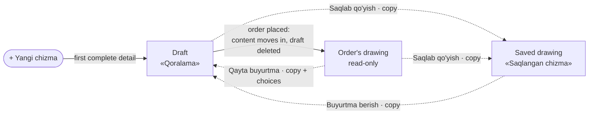

# Drawings and cutting

The client's **drawing** — a parts list grouped into material groups — and the 2D guillotine
cutting-stock solver that lays it out. A drawing names no workshop, no decor and no price: those
are chosen when it is ordered ([`orders.md`](orders.md#placing-an-order)), and that is where the
optimiser runs, against the chosen branch's formats and saw. Cutting is its own module — no
pricing, no payment, no stock logic.

## Problem

The client the app is built for is an **usta** — a furniture maker who designs a cabinet,
writes its parts list per material, and takes it to a cutting workshop. Ustas know the design
before they know the decor: which white, which oak, depends on what the workshop has that
week, and is often settled with the workshop on the phone. A drawing that demanded a branch
and a decor before its first part made them learn a catalog to write down a design, and every
decor change rewired the list.

A real job is several materials at once — a carcass, fronts, a back panel — and the banding
differs edge by edge: thick where it shows, thin where it hides. Part dimensions depend on the
board's thickness (a shelf between two 16 mm sides is 4 mm longer than between two 18 mm
ones), but not on its sheet size or decor. And a good design gets built again for the next
client — while most drawings are one-offs that belong to the job they were drawn for.

## Domain rules

### What a drawing is

A drawing is **material groups holding parts**
([shape](../entities/cutting.md#the-drawings-content)):

- **A group is one decor slot.** It carries a substrate type and a thickness — both required —
  and optionally a sheet size and a name. At the order step each group gets one decor (or is
  left to the workshop). Two groups may share a type and thickness: a white carcass and an oak
  front are two groups of LDSP 16, told apart by name.
- **Thickness is design, sheet size is not.** A part's dimensions are drawn for its board's
  thickness, so the order step offers only decors in that thickness. The sheet size only moves
  the sheet count, so it is optional: given, the drawing estimates; omitted, the decor chosen
  at the order step decides it.
- **A part** is a name, length × width, quantity, whether it follows the grain
  ([Grain](#grain)), the thickness of tape on each banded side ([Kromka](#kromka)) and, staff
  only, the thickening instruction.
- **No branch, no decor, no price, no tape colour.** Those are commercial choices and belong to
  the order — which is why a drawing can be ordered at any of the client's workshops, and
  again.
- **A group is manual or MAP.** A manual group is edited freely and optimised at the order
  step; a [MAP group](#map-groups) is a 2D-Place layout imported by the workshop, and locked.

### Lifecycle

- **A draft** is created by its first complete detail and autosaved after it — empty, named or
  incomplete editors never consume a draft slot. It is private, persists until deleted, and a
  client holds at most 50.
- **Ordering moves the drawing into the order.** The order step runs on the draft; placement
  binds its content and result to the order and deletes the draft. From then on the drawing is
  read inside its order, and changed only by a staff
  [revision](orders.md#revising-a-placed-order).
- **A saved drawing is a copy the usta chose to keep** — and nothing else lands in the
  library. An usta does not reuse one client's drawing for another (owner, 2026-10-17), so an
  automatic library would fill with one-offs. Three ways to save, all copies: the editor's
  bookmark (the drawing as it is now), the confirmation step's «Chizmani saqlab qo'yish»
  checkbox (as placed — off by default), and **Saqlab qo'yish** on an order (its drawing).
  Saved drawings carry no decor: the next order picks again, wherever it is placed.
- **Copy, never link.** Ordering a saved drawing copies it into a new draft, so tweaking one
  client's cabinet from 1800 to 2000 mm never alters the template, and editing a saved drawing
  never reaches an order. **Qayta buyurtma** copies an order's drawing together with its
  choices ([`orders.md`](orders.md#re-ordering)).

### The estimate

A manual group with a sheet size shows **«≈ N list»** while it is drawn. It is a real
optimiser run with the platform's default saw settings (kerf 4 mm, edge trim 5 mm) and the
grain followed as drawn, since no decor is known yet. It runs on demand after edits settle,
is **never stored**, and is always labelled *taxminan*: the order step's count uses the chosen
branch's saw and the chosen decor's format and grain, and may differ by a sheet either way. A
group without a sheet size reads *buyurtmada hisoblanadi*; a MAP group shows its file's exact
sheet count.

### Grain

Each part stores `follow_grain`, **default on**, meaning *this part follows the grain if its
board has one*. Whether it actually locks is decided by the board chosen at the order step:

| Decor (or customer board) has grain | Part follows grain | Rotation |
| --- | --- | --- |
| yes | yes | locked — never turned 90° |
| yes | no | free |
| no | yes | free |
| no | no | free |

*Why the decor gates it.* The drawing cannot know the decor, so the part states intent and the
decor decides. The default protects the expensive mistake — a wood front cut across its grain
— and costs nothing on a plain board, where every part rotates. Until 2026-10 the flag alone
locked a part and new rows started free; once the decor left the drawing, that pairing would
have let an usta draw unaware and cut an oak door sideways. Revisit if workshops name plain
decors with a direction (brushed, structured): that is a per-decor flag, not a return to the
old rule.

The estimate locks as drawn (the conservative reading); a MAP layout is copied as laid out. A
locked part that cannot fit its board in the forced orientation fails with `impossible_grain`.

### Kromka

- **The drawing names thicknesses, the order names the tape.** Each side of a part is
  unbanded or banded at one of the editor's thicknesses — **0.4 · 1 · 2 mm**. At the order
  step each group picks one tape decor — by default the branch's tape of the panel's own decor
  — and every banded side resolves to that decor's format at its thickness, falling back to
  the nearest thickness the decor exists in and saying so once. One tape decor per group is
  the shop floor's own rule: one colour per board, thick where it shows.
- **The tape's width follows the board.** The narrowest tape the branch carries that covers
  the group's thickness — doubled on a thickened part — is used; a decor carried only in
  narrower tape is marked in the tape picker but stays selectable.
- **Thickening (`УТ`) is an instruction, not geometry.** A part may be flagged `thickened`
  (utolshenie / obmanka): the workshop glues a strip of the same panel underneath so the
  visible edge reads twice as thick. The strip is never planned — not placed, not counted, not
  priced — and flipping the flag invalidates nothing. It doubles the edge the tape must cover.
  The flag is per part, not per side, a deliberate simplification for the rarer one-sided
  case. Staff-only: a client never orders thickening. It is stamped `УТ` in the parts list, on
  the drawing and on the PDF map.

### MAP groups

A **MAP group** is a 2D-Place `.map` layout the workshop imported ([Imports](#imports)). The
file holds positions, sizes, names and which sides are banded — **no rotation permission, no
grain, no material and no thickness**. Re-optimising such a layout would guess the one thing
that matters on a grained board, and the shops trust the layout they made in 2D-Place. So
(owner, 2026-10-17):

- **Its geometry is locked.** No part is added or removed and no size, quantity or grain
  changes; it is never re-optimised. Names, banded sides and their thickness, and `УТ` stay
  editable — none moves a placement. The whole group may be deleted. Changing the layout means
  fixing it in 2D-Place and importing again.
- **It mixes with manual groups.** A 2D-Place file usually holds one client's one decor
  (all seventeen fixture files have one sheet size and are named `Client__Decor`), while a job
  has several materials — so a drawing takes several MAP groups and manual groups together,
  and the whole job is one order.
- **Its saw settings come from the file.** Kerf is the most common gap between two facing parts
  across the whole layout; edge trim the most common inset of a part from its sheet's edge;
  each falls back to 0 when the layout gives no evidence, and to 0 when out of the range a
  branch accepts. These figures are display only.
- **It orders only where it fits.** The chosen format must match the layout's sheet size
  exactly, and a branch qualifies only if its saw is no larger than the layout — checked on the
  geometry itself: the smallest gap between facing parts is at least the branch's kerf, and the
  smallest inset of a part from a sheet edge is at least the branch's edge trim. A sheet with a
  single part sets no kerf bound. Who imported the file does not matter. *Why the geometry and
  not the derived numbers:* those are a mode with a zero fallback, so a sheet of one big part
  would read kerf 0 and block every workshop, and a lone 3 mm gap in a 4 mm layout would slip
  past them.
- Waste and cut metrics are recomputed from the placements; the file's waste and remainder
  rectangles become sheet `offcuts`, for preview only. The UI calls the group's layout
  **Fayldan joylashuv**.

### The optimiser

- **It runs at the order step, never in the editor.** The editor only estimates. The order
  step — and staff resolving or revising an order — runs one optimisation over the whole
  drawing against the chosen materials.
- **One run, every group, one result.** Manual groups mapped to the **same** branch material
  are optimised together and share sheets — one physical board, split in the drawing only for
  readability. A MAP group's placements are copied onto its chosen format. A group on the
  client's own sheets is optimised on the customer board's size. The engine may evaluate
  native and PackingSolver candidates internally, validates and scores them with one
  engine-owned policy, and returns only the winner per material; the client never selects a
  solver. Provider orchestration and fallback are the cutting engine's contract.
- **Guillotine cuts only.** A cut runs edge to edge; non-guillotine, L-shaped and CNC paths are
  out of scope.
- **One branch material → one sheet size**, its format's.
- **Kerf, edge trim and edge overhang are the chosen branch's settings**
  ([`workshop.md`](workshop.md)) for every optimised group; a MAP group keeps its own layout.
- **Edge-banding length is computed here.** For each banded side the length is the part's
  length (top/bottom) or width (left/right), rolled up per tape material — the geometric
  length. The metres an order bills and consumes add the branch's per-side overhang, once per
  banded side ([`orders.md`](orders.md#pricing)); the optimiser emits both.
- **No stock check and no pricing.** The optimiser says "N sheets of material X" and "L metres
  of tape Y". Stock never gates it, and price first appears in the order.

### Limits

| Constraint | Value |
| --- | --- |
| Part minimum | 10 mm × 10 mm |
| Part maximum | sheet − 2× edge trim — the group's sheet size in the editor, the chosen format at the order step |
| Parts per drawing | ≤ 100 rows · ≤ 300 pieces |
| Panels per material per result | ≤ 20 (a larger job is split into separate orders) |
| Open self-made drafts per client | ≤ 50 (anti-abuse; staff-minted drafts don't count) |
| Saved drawings per client | ≤ 200 (anti-abuse; raise when a real usta reaches it) |
| Import file | ≤ 1 MiB, 2D-Place `.map` only |
| Hard timeout per run | 10 s → `optimization_timeout` |

### Access

- A client sees only their own self-made drafts, their saved drawings, and the drawings inside
  their orders. **Saved drawings are never visible to any workshop.**
- A draft minted by workshop staff for a walk-in
  ([`orders.md`](orders.md#staff-created-orders-walk-in-clients)) is stamped with the creating
  workshop and is **workshop-scoped, not branch-scoped**: any staffer holding `manage_orders`
  there may pick it up, because the colleague who started it may be off-shift. It is invisible
  to the client until the order is placed (symmetric privacy: staff never see a client's own
  drafts either) and outside the client's draft cap. Outside the minting workshop it does not
  exist (404, no existence oracle).
- Unfinished staff-minted drafts are listed on the workshop's **Qoralamalar** surface
  ([Workshop editor](#workshop-editor)); an order's revision draft never appears there.
- Workshop staff in scope see an order's drawing and result; the PDF is gated the same way.
  Every optimisation run is audited.

## User stories

- As an usta, I want to write the parts list before I know the workshop or the decor, so I
  design once and choose the boards with the workshop.
- As an usta, I want the thickness fixed in the drawing and the sheet size optional, so the
  parts stay correct and I can still see roughly how many sheets it takes.
- As an usta, I want to keep my standard cabinets as saved drawings and order them again in
  any decor at any of my workshops — without one client's tweaks changing the template.
- As an usta, I want to type a 40-line paper list on my phone without fighting the keyboard.
- As an usta, I want to mark each banded edge with its thickness and leave the tape colour to
  the board I pick.
- As workshop staff, I want to import a 2D-Place `.map` file and keep its exact layout, and add
  the materials it doesn't cover to the same order.
- As a cutter, I want the confirmed layout and PDF at the saw, so I can cut without
  translation.

## Imports

**Importing is workshop-side, and `.map` is the only format.** The client app has no entry to
it. The CSV and БАЗИС-Мебельщик XML importers are removed (owner, 2026-10-17): neither format
is fixed — every export variant needed its own column mapping and the result still had to be
checked line by line — while the 2D-Place layout is the file the shops already trust. Revisit
if ustas ask to bring Excel lists: a paste-into-table with a fixed column order is the smaller
tool, not a new file importer.

The **MAP fayl import** dialog parses the file the moment it is chosen:

1. **File strip** — the file name, `N list · M xil · K detal`, the saw settings derived from
   the layout, and **Boshqa fayl** to start over. Diagnostics — waste and remainder records,
   anything skipped — expand in place, ahead of the commit.
2. **One block per sheet size** (one file usually has one), each becoming a MAP group: the
   group name, prefilled from the file name after `__` (`Ilhom aka__Arusha Venge.map` →
   «Arusha Venge»); **Material turi** and **Qalinlik**, both required because the file carries
   neither; and, when the file marks banded sides, one **kromka thickness** applied to all of
   them, editable per part afterwards.
3. **Where it goes** — a new draft for the resolved walk-in client, named after the file, or
   the draft already open, which gains the groups.

The commit validates the layout before anything is stored: every placement must match a
generated part, overlapping and out-of-bounds placements are refused, and a file over 300
pieces is rejected at parse time. The footer carries one primary action, **Import qilish**,
disabled until every block has its type and thickness.

## UX

**One drawing model, two editors.** The client app is phone-first; the workshop app is a dense
desktop table over the same groups and parts. Where nothing is said, both behave alike.

### Chizmalar (client)

The **Chizmalar** tab holds every drawing not yet ordered, under two segments, each with its
count:

- **Saqlanganlar** (the default) — the saved drawings, with a search by name. A row shows the
  name, `{n} guruh · {m} detal` (plus the sheet count when a MAP group is inside, with a
  **Fayldan** pill), and `{k} marta buyurtma qilingan · oxirgisi {sana}` or *Hali buyurtma
  qilinmagan*. The row opens the [saved drawing](#saved-drawing-page). Empty: *Saqlangan chizma
  yo'q* — saved from inside a drawing or from an order.
- **Qoralamalar** — the drafts, most recently changed first; the row opens the editor. A
  caption says that ordering moves a drawing into its order. Empty: *Qoralama yo'q* with
  **+ Yangi chizma**.

**+ Yangi chizma** heads the page (and home). Home keeps its *Davom ettirish* section of up to
three drafts ([`orders.md`](orders.md#ux-client-app)).

*Why one tab with two segments* (owner, 2026-10-17): every drawing that is not yet an order
lives in one place; the alternative — drafts on home only, and a tab of saved drawings —
hid every draft past the third.

### Saved drawing page

- **Header** — the name, *Saqlangan · {k} marta buyurtma qilingan*, and a ⋯ menu: rename,
  edit, delete.
- **Tarkibi** — each group's name, type · thickness · sheet size, its detail count and
  estimate; **Detallarni ko'rish** opens the editor on the saved drawing itself — editing it
  changes the template, which is the point of opening it there.
- **Oxirgi buyurtmalar** — the orders placed from it: number, workshop, date and the decors
  each one used; the row opens the order.
- **Actions** — **Nusxasini o'zgartirish** (a copy, opened in the editor) and the primary
  **Buyurtma berish** (a copy, opened at the order step), over the line *Saqlangan chizma
  o'zgarmaydi — buyurtmaga uning nusxasi ketadi.*

### Editor (client)

- **Header** — back, the name (inline-editable), the meta line *Qoralama · {n} guruh · {m}
  detal*, a **bookmark** button that saves a copy to Saqlanganlar (a toast with **Ochish**;
  later edits do not follow the copy), and ⋯ with rename and delete. The word *saqlandi* is not
  used for autosave: next to a library called «Saqlangan chizmalar» it would claim the drawing
  is in it.
- **Group cards.** The head carries the name with an edit button, chips for type · thickness ·
  sheet size — a dashed **+ list o'lchami** chip when it is missing — and the estimate at
  the right: **≈ 3 list** over *taxminan*, or **— list** over *buyurtmada hisoblanadi*. A row is
  name over `length × width`, the quantity (`2 ta`), the kromka glyph with its thickness
  (`2`, `0,4`, `—`) and the grain glyph — the grain mark in signal orange when the part follows
  the grain, a rotate mark when it is free. The row opens the part sheet. A dashed **Detal
  qo'shish** closes each group; **Guruh qo'shish** follows the last one, then one line naming
  the estimate's assumptions.
- **Sticky bar** — `{n} detal` over the groups' estimate, and the one primary action,
  **Buyurtma berish**. When something blocks ordering — an empty group, an incomplete row, a
  part longer than its group's sheet — the reason shows inline beside the disabled button and
  the row is flagged.
- **Group sheet** — *Guruh nomi* (optional, with a line saying a name tells two groups of one
  material apart), **Material turi** chips (the panel types), **Qalinlik** chips for that type
  with a sensible default (16 for LDSP) and *Boshqa*, and **List o'lchami** chips — *Bilmayman*
  (default), the common sizes, *Boshqa* — under a line saying what the size changes. Changing
  the thickness of a group that has parts asks first: its parts were drawn for the old one.
- **Part sheet** — *Nomi*, *Uzunligi* and *Eni* in millimetres, *Soni* with − / + steppers, the
  **Teksturaga ergashadi** switch with its consequence spelled out (*yog'och naqshli dekorda
  burilmaydi, bir rangli dekorda optimallashtirish o'zi buradi*), and the kromka block:
  - **Painting.** A thickness segment (**0,4 · 1 · 2** mm) and a diagram of the part drawn to
    its proportions, its four sides as buttons — a tap applies the selected thickness, a tap
    on a side already at that thickness clears it. **Hammasi** and **Tozalash** sit on the
    block's head; a summary line names the thicknesses used and the tape metres for the whole
    quantity. Each side carries an accessible name (*Uzun tomon (old): 2 mm*).
  - Staff alone see the `УТ` toggle under the sides it changes.
  - Actions: delete (with an undo toast), **Saqlab, yana qo'shish**, and the primary
    **Saqlash**.
- **Tez kiritish** — an entry mode for long lists, switched on from a group. The page keeps the
  group picker, the group's latest rows with the one just added highlighted (and *Bekor
  qilish*), and docks an entry panel over the bottom: *Nomi*, *Uzunligi*, *Eni*, *Soni* with
  the active field outlined, a row of kromka presets — *Kromkasiz · 1 uzun · 2 uzun · Hammasi*
  — beside a thickness segment, and an on-screen keypad: digits, `00`, ⌫, **Keyingi**, the
  grain toggle and **Qo'shish**. The phone's keyboard never opens, so nothing jumps; **Keyingi**
  walks *Uzunlik → Eni → Soni* and **Qo'shish** appends the row and returns to *Uzunlik* with the
  name, kromka and grain kept. Anything the presets cannot say is the part sheet's.

### Workshop editor

- **The same groups as a dense table** — `# · Nomi · Uzunligi · Eni · Soni · Kromka · УТ` per
  group, the group head above it. `Enter` moves through `Nomi → Uzunlik → Eni → Soni` and
  appends an inherited row from the last cell of the last row; `↑` / `↓` step the focused
  number by 1 and `Shift` by 10, floored at 0 (1 for *Soni*). There is no ceiling: an
  oversized part and the 300-piece budget fail with named errors. Deleting a row shows an undo
  toast; a checkbox column offers bulk delete.
- **Kromka is a card docked beside the board**, not a modal: it shows the selected row's name,
  size, the painting diagram, the thickness segment and `УТ`, levels itself with the selected
  row, and has no empty state — with nothing selected there is nothing to say. Clicking a row
  or focusing a cell selects it; `Esc` clears the selection. On a narrow window the card
  stacks under the board.
- **A MAP group** heads its table with a lock, its name, a **Fayldan joylashuv** pill, the
  spec line (type · thickness · sheet size · sheets · kerf · trim), **Listlarni ko'rish**, and
  one line: *Detallar, o'lchamlar va soni fayldan — o'zgartirish uchun 2D-Place'da tuzatib,
  qayta import qiling*. Its geometry cells are plain text; names, kromka and `УТ` stay
  editable.
- **Header and bar.** A persistent strip names the walk-in client (name + phone) and is
  rehydrated when a saved draft is resumed. **+ MAP fayl** and **+ Guruh** sit with the
  title; the sticky bar carries the counts — each MAP group's exact sheets, the rest *buyurtmada
  hisoblanadi* — and **Buyurtmaga o'tish**, which opens the order step at the staffer's branch,
  frozen into the draft at creation.
- **Qoralamalar** (`/workshop/orders/drafts`, `manage_orders`) — the workshop's unfinished
  walk-in drawings, reached from a **Qoralamalar** entry at the right end of the Orders
  screen's filter row with a count of open drafts. It was *Saqlangan chizmalar* until
  2026-10; the client's library now owns that word, and one word must not name two things
  across apps the two sides talk across. The list follows the selected branch; each row shows
  the walk-in client (name + phone), the branch, the part count, and a derived label —
  *Buyurtmaga tayyor* once every group has a material, else *Tahrirlanmoqda*. **Davom etish**
  reopens the draft; a per-row delete discards it with a danger confirmation. States: loading
  / empty (*Qoralama yo'q* → start via the sidebar's **+ Yangi buyurtma**) / error, each
  recoverable.

### Deleting a drawing

A draft or a saved drawing is deleted from its ⋯ menu. The danger confirmation names it and
its part count: *«{name}» — {N} detalli chizma butunlay o'chiriladi.* A failed deletion keeps
the dialog open with the error and its trace id; success returns to the list it came from.
Deleting a saved drawing never touches an order or a draft copied from it.

### Results

**The editor never shows a result** — only the estimate. A result is drawn in three places,
by one component: the order step's confirmation ([`orders.md`](orders.md#placing-an-order)),
an order's **Chizma** tab, and the staff preview when materials are resolved.

**768px is the line between the two readings of a result.** A 2800 mm sheet inside a 390 px
viewport draws at roughly a 7× reduction, where no part label and no dimension survives — the
fitting thresholds working as designed, not a rendering defect. So below 768px the drawing
demotes to a navigational overview and a text parts list beneath it carries the numbers; from
768px up the drawing is legible and the per-sheet rail beside it carries the detail. The two
never show together: one screen, one authoritative reading. 768px is the app's own desktop
boundary (the root paints at `zoom: 90%` from 769px), so the switch lands where the layout
already changes character.

**The result leads with its figures** — `Detallar`, `Listlar`, `Kromka`, `Foydali qoldiq` and,
on the workshop only, `Chiqim` — label first, value beneath, composed by one helper for both
apps so a figure cannot be worded one way at the counter and another at home. A value carries
its unit and, for the offcut, its count («2 dona · 2.50 m²»), so the cell floors at 150px and
no figure wraps mid-phrase. Each material then gets one row: swatch, name and size, and (staff)
its source chip and its own fill bar. The client reads four of the five: `Chiqim` — the share of
the sheets turned into parts, area-weighted so a small offcut-heavy board cannot outvote the
ones the money is in — is the shop's figure, and a client quoted a fixed price cannot act on
it. On phones the four render as a 2×2 grid.

**Staff also get every sheet at once.** On the staff confirmation a **Kesish xaritasi** card
shows each sheet as a small map in an auto-filling grid — "how many boards, how full is each"
for an operator deciding to place, where the large drawing answers "where does this part go"
for the cutter. Each small map is told its real render width, because the label-fitting
thresholds are expressed against an 800px drawing.

1. **Panel layout visualiser.**
   - A sheet thumbnail strip grouped by panel material; each group header shows the material
     type, label and sheet count, and each thumbnail drawing-wide `List N` numbering and a fill
     badge. A MAP group's sheets carry the **Fayldan joylashuv** mark.
   - Above the drawing, one caption names the sheet: `List {n} · {material} · {fill}
     ishlatildi` — the share of the board the layout consumes. (`KIM` until 2026-08: the
     nesting engineer's abbreviation, which operators do not use.)
   - The active sheet renders as an interactive SVG; each placed part carries its display name
     centred, a `↻` marker when the optimiser rotated it, and its two dimensions set against
     the sides they measure. Each number renders independently, so a thin strip still shows the
     dimension that fits. Offcuts overlay as dashed outlines: green `Qoldiq …×…` when usable, red
     `chiqit` when waste, with one label-fitting ladder in SVG and PDF.
   - Selecting a details row highlights its placements and dims the rest; clicking a placement
     selects its part group and scrolls its row into view; clicking the background clears.
   - **Banded sides** are a short centred tick inside the placed rectangle, on each banded side
     only, in **its own tape's colour** over a white gutter and a dark hairline — pale tape on a
     white part would otherwise read as nothing. A tape the drawing never numbered falls back to
     neutral ink, not accent. The side mapping follows the part's own edges; a rotated placement
     maps them 90° clockwise.
   - **Grain-locked parts** — those the [grain rule](#grain) locks — are filled with hairlines
     parallel to the sheet's long side, tiled from the sheet so neighbours share one ladder, in
     `ink` at 17%, under the numbers and ticks. The `↻` says the optimiser *did* turn a part;
     the hairlines say it *may not*.
   - From 768px up the left rail lists each panel material with its sheet count, the tapes with
     a dot in the drawing's colour, the label (`Egger H1334 ST9 · Sanoma · 0.4×20 mm`) and
     consumed metres, then the parts of the active sheet (`Detallar — List N`). Result data is
     frozen from the result's snapshots, so it stays self-contained.
   - **Workshop only:** each panel-material row carries a source chip — `Mijoz materiali` on a
     customer board or an own-sheet claim, `Ombordan` otherwise — and that material's own fill.
     The client's row is the material and its sheet count, nothing else.
   - Below 768px the rail becomes a **`Detallar` list beneath the drawing** covering the whole
     result: one `List N` group per sheet, the material printed once per run, one row per part
     (name, `length × width mm`, quantity, rotated count), in `parts_snapshot` order. Tapping a
     row selects the part, switching sheets when needed; tapping a placement scrolls its row
     into view.

2. **PDF.** The print-ready cutting document opens in a new browser tab, never saved to disk:
   the reader wants to look at or print it, and the browser's viewer offers both plus a
   download. The tab is opened synchronously in the click handler with an object URL fetched
   on the user's token, because a popup opened after an await is blocked; a blocked popup
   says so and never falls back to downloading.
   - Fixed A4 portrait, starting with a **Xulosa** page: title block, per-material stats, tape
     specification and the usable-offcut inventory; sheet pages follow, consecutive identical
     layouts grouped (`List 1–2`, `2 dona list`) while counts include every sheet.
   - An **order's** document leads with **Hisob-kitob** — the receipt on paper: one row per
     sheet material, tape, service and adjustment, each with its multiplication
     (`3 list × 30 000`), a bold total and the same `Jami` in the title block, rebuilt from the
     order's own frozen prices and printed before the production tables. A client-supplied
     material prints `o'zingizniki` and, on the order, the sheets the client brings.
   - Summary cells wrap instead of truncating; the page planner measures the heights it
     draws. `Ishlatildi` is parts area over sheet area, `Qoldiq bilan` adds usable offcuts.
   - Work cards: two layout units per A4 portrait page, an odd one alone at the top; four
     header lines (sheet range · material · `Kromkalar` · area, fill, offcut, waste), then the
     map beside an `Uzunlik · Kenglik · Soni` register; a register too long for its slot
     continues on a `Detallar (davomi)` page. Every page is numbered.
   - **Parity is narrow on purpose**: the map panel mirrors the web visualiser's geometry, label
     fitting, offcuts, ticks and grain hairlines (composited by hand, no transparency group for a
     shop RIP to flatten); the rest of the document is PDF-own. Text uses an embedded Unicode
     font.
   - **A sheet's millimetres are resolved, never assumed.** The size is read from the result's
     material snapshot across all three frozen vocabularies, and when none carries it, derived
     from the layout — placements plus offcuts span the sheet, minus at most the edge trim. There
     is no constant fallback: until 2026-09 a flat 1000×700 default rescaled whole drawings with
     nothing to signal it.

### An order's drawing

Inside an order the drawing is read-only — its groups with the decors chosen for them, the
parts, the result and the PDF — and carries **Saqlab qo'yish** (a copy to Saqlanganlar,
decor-less) and **Qayta buyurtma** ([`orders.md`](orders.md#re-ordering)). Changing it is a
staff revision, pre-production only.

## Edge cases

- **`part_too_small` / `part_too_large`** — outside the bounds of the group's sheet size in the
  editor, or of the chosen format at the order step → the row is flagged with the maximum, and
  the order step refuses a format the part cannot fit.
- **`impossible_grain`** — a part locked by the grain rule cannot fit the chosen board in its
  forced orientation → the order step names the part; picking a plain decor or freeing the part
  resolves it.
- **`too_many_parts` / `too_many_panels_needed`** — over the caps → refuse; split the job.
- **`optimization_timeout`** — no result within 10 s → retry or simplify; an estimate that
  times out simply shows no figure.
- **`draft_limit_exceeded` / `saved_drawing_limit_exceeded`** — over 50 drafts or 200 saved
  drawings → delete some first.
- **`map_group_locked`** — a geometry change sent for a MAP group → refused; the editor offers
  no such control, so this only guards the API.
- **Unsupported import file** — anything but a `.map` (including the retired CSV and XML), an
  empty, oversized or corrupt file → refused with a clear error before it touches a drawing.
- **MAP layout with overlapping or out-of-bounds placements** → refused at commit.
- **A drawing whose MAP group fits no workshop** → every row on the order step's first step is
  disabled with its reason (kerf, trim or missing sheet size); the drawing itself is untouched.
- **Thickness changed on a group with parts** → allowed after the confirmation; nothing is
  rescaled — the parts were the usta's to adjust.
- **A saved drawing deleted while a draft copied from it is open** → the draft is unaffected;
  only its provenance points nowhere.
- **Algorithm replaced later** → confirmed results keep their stamp and their PDFs are not
  regenerated.
- **`cutting_result_not_usable`** — the order step finds the draft already placed (a second
  tab, a back-navigation) → redirect to the order.

## Next

- [`orders.md`](orders.md) — the order step that turns a drawing into a priced layout, and what
  happens to it after.
- [`catalog-inventory.md`](catalog-inventory.md) — the decors and formats the order step picks
  from.
- [PackingSolver provider spec](https://github.com/BerdiyorovAbrorjon/cutting-engine/blob/main/docs/PACKINGSOLVER_PROVIDER_SPEC.md)
  — the internal multi-provider optimiser contract, validation, fallback and deployment rules.
